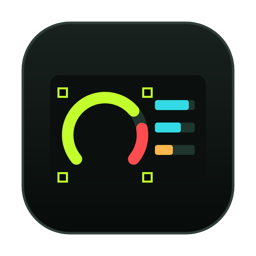
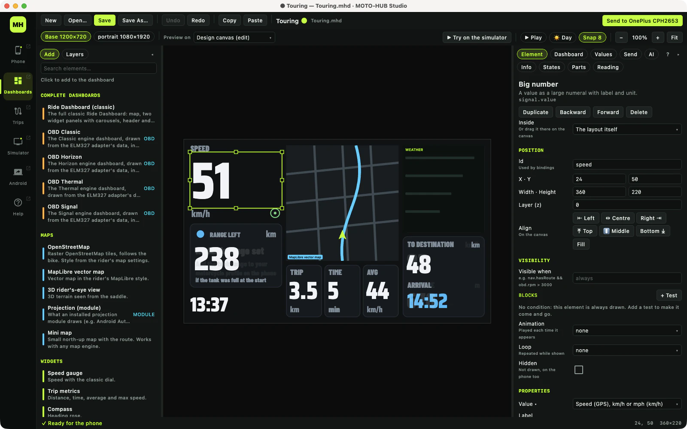
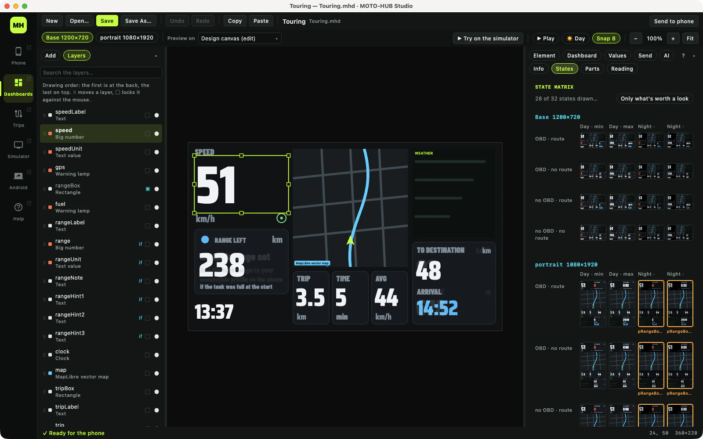
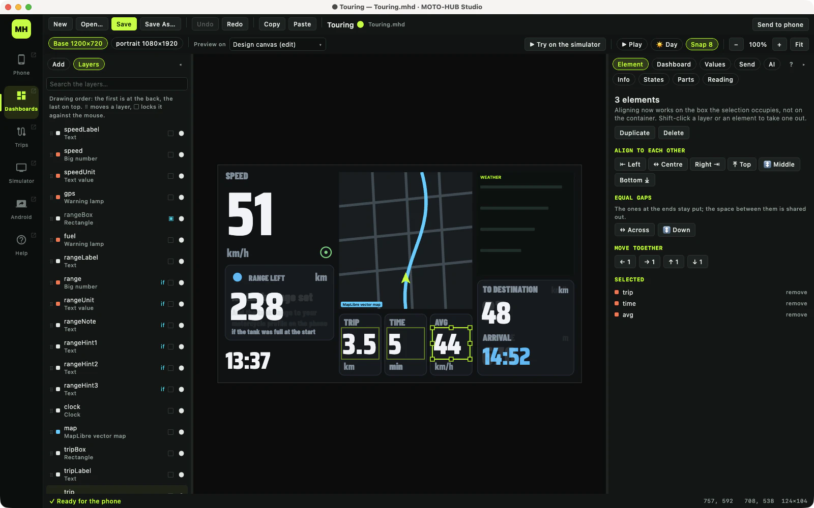
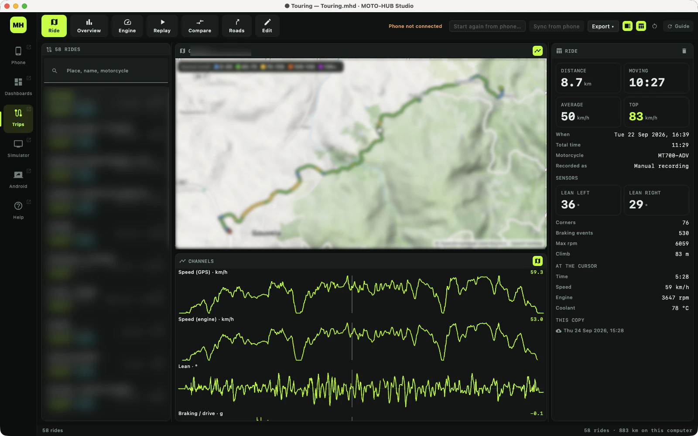
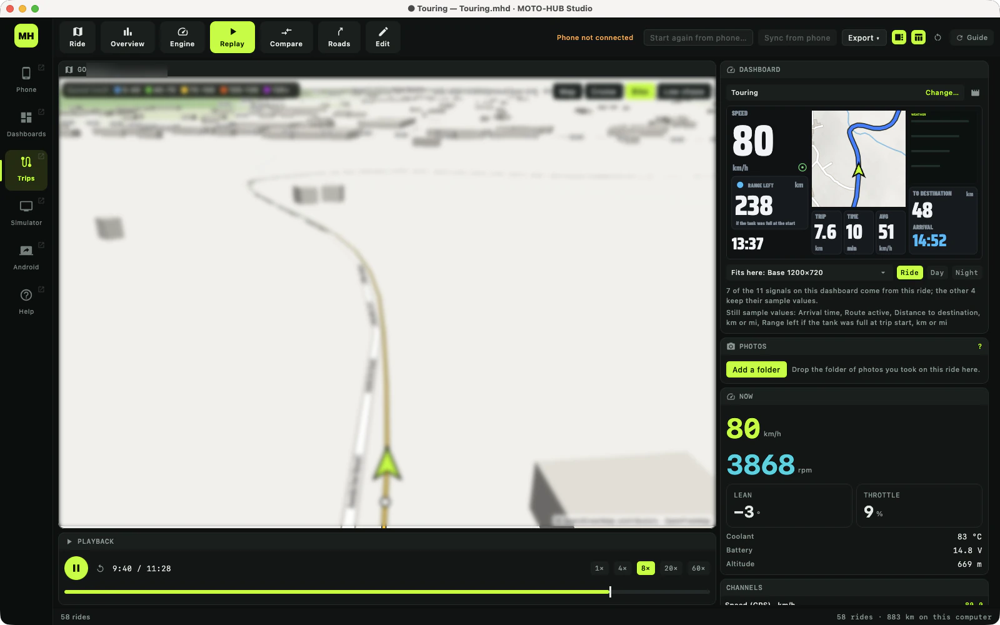
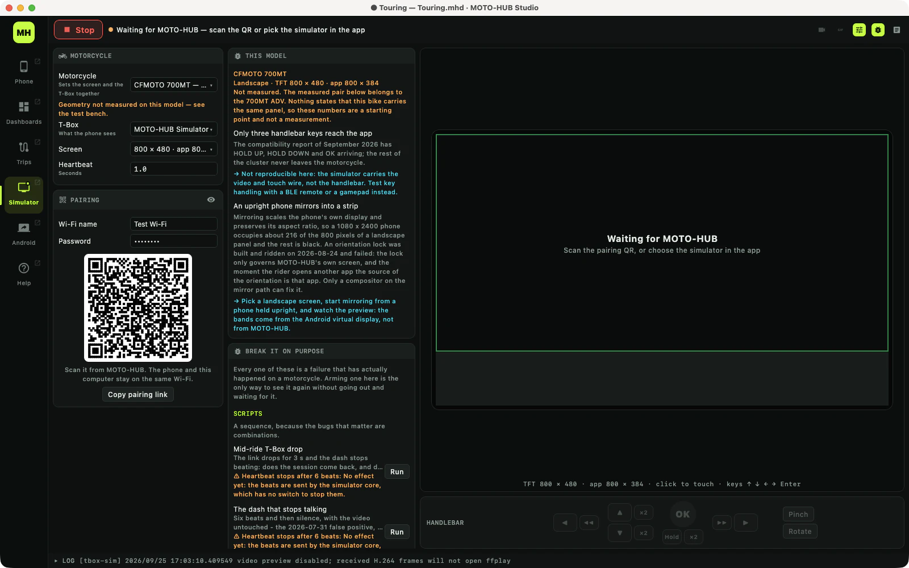
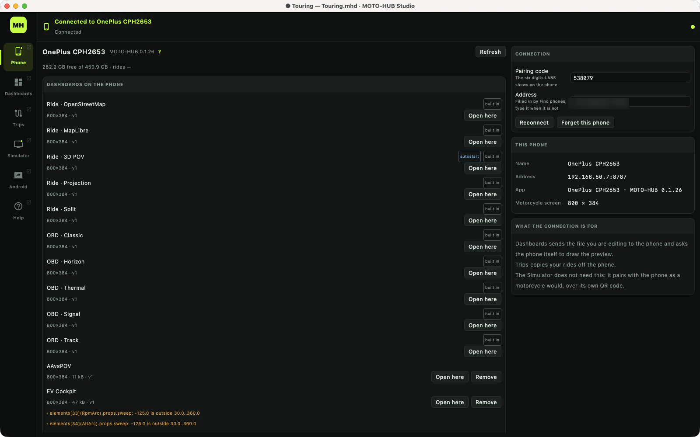
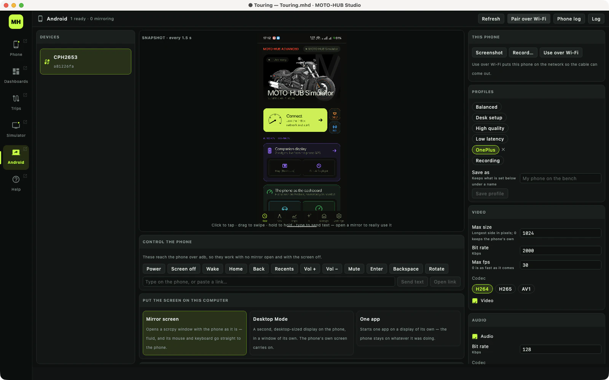

# MOTO-HUB Studio

**The desktop companion of MOTO-HUB, for macOS, Windows and Linux.** 
**Design dashboards for your motorcycle's TFT, study every ride you have recorded, and test it all on a simulated bike before you ride.**

> [!IMPORTANT]
> **MOTO-HUB Studio is free, but it needs a free licence key to open.** Download it from the
> **[latest release](https://github.com/vincenzobpt/MOTO-HUB-Studio-releases/releases/latest)**, open it, and press
> **Get a free licence**: the [MOTO-HUB website](https://motohub.techub.eu/studio/licence/) gives you a key for your computer in a minute.

## Scanned for malware

<!-- virustotal:start -->
Every Studio package is scanned by [VirusTotal](https://www.virustotal.com), which checks it with dozens of
antivirus engines. For **Studio 2.7.0**, 1 of 56 engines flagged the macOS package: Microsoft's machine-learning heuristic reports it as `Trojan:Script/Wacatac.B!ml`. The other 55 engines found nothing, and the Windows and Linux packages are clean. We believe it is a false positive and have not been able to confirm it yet. Open the reports yourself:

| Package | VirusTotal report | SHA-256 |
|---|---|---|
| 🍎 macOS | [**1/56 detections**](https://www.virustotal.com/gui/file/dbe496952792eadf372724ec6856d0c037889e45fb97e88e32cf26d5cc7ba519) | `dbe496952792eadf372724ec6856d0c037889e45fb97e88e32cf26d5cc7ba519` |
| 🪟 Windows | [**0/52 detections**](https://www.virustotal.com/gui/file/115797ddb636c4f2c5415f319b345d099f407db26134446678d5b0221cf19888) | `115797ddb636c4f2c5415f319b345d099f407db26134446678d5b0221cf19888` |
| 🐧 Linux | [**0/52 detections**](https://www.virustotal.com/gui/file/fbb5d6e99bebc644aac78ba5737f2f80cb5685f7bdbc94f18b8723f4292da5c3) | `fbb5d6e99bebc644aac78ba5737f2f80cb5685f7bdbc94f18b8723f4292da5c3` |

The SHA-256 tells you that your download is the same file VirusTotal scanned: it must match the one on the report page.
<!-- virustotal:end -->

---

## What it is

[MOTO-HUB](https://motohub.techub.eu) is the phone app that puts navigation, ride recording and a full
engine readout on your motorcycle's TFT, or on the phone itself when the bike has no compatible screen.
**Studio is the other half, on your computer.** Everything MOTO-HUB shows on the bike can be designed
here, everything it records can be studied here, and the link between the two can be tested here
without starting the engine.

Studio talks to the phone over your Wi-Fi: it sends it dashboards, previews them live on the phone,
copies your rides off it and backs the whole phone up. No cable, no account, no cloud. Your rides stay
on your phone and your computer.

## What it does

Six workspaces, one per job, down the left edge of the window. Any of them can be pulled out into a
window of its own, so a dashboard can sit on one screen while the simulator plays it on the other.

### 🎨 Dashboards: a real editor for the TFT

Design the screen your motorcycle shows, element by element: speed, maps, 3D rider's-eye view, engine
data from an OBD adapter, turn-by-turn, lap timer, lean angle, weather and more, **62 elements** in all.
The canvas works in the dashboard's own units, so one file fits TFTs of different sizes, and extra
layouts cover portrait or ultra-wide screens.

- **Every state at once.** Day and night, with and without engine data, navigating or not, every value
  at its extremes: a matrix draws the whole dashboard in each state, so the bugs that only show up on
  the road are found at the desk.
- **Readability, measured.** Studio knows the size of the TFT and how far away your eyes are, and flags
  every figure too small to read at riding speed, with the fix.
- **Conditions without code.** "Show this when OBD is connected and the revs are above 3000" is two
  blocks, not an expression.
- **Components.** Save a gauge you are proud of and reuse it everywhere; improve it once and update every copy.
- **An AI assistant.** Describe the dashboard you want and it builds it with the editor's own tools, one
  undo step per request. It works with any OpenAI-compatible endpoint, including local models.
- **Send to the phone** in one click, and watch a live preview drawn by the phone itself.

&nbsp;

### 🏍️ Trips: every ride, studied

Sync the rides MOTO-HUB recorded on your phone (both ways, with edits travelling back) and look at
them properly on a big screen.

- **Ride:** the track coloured by speed, every sensor channel on one timeline, and a cursor that moves
  map and charts together.
- **Replay:** the ride played back on a real map, from above or in 3D behind the rider, **with any of
  your dashboards playing along** on the data you actually recorded.
- **Overview:** the whole season at a glance, a heat map of where you ride most, service reminders by
  kilometre.
- **Engine:** time at each rpm, gear usage, temperatures and charging, from the OBD adapter.
- **Compare and Roads:** two rides side by side, every corner detected and matched across your library
  ("this corner, the last six times"), and timed segments.
- **Your dashboard over your footage:** pick the video you filmed on the ride, and Studio draws your
  own dashboard over it, driven by the ride's data.
- Export tracks as **GPX** or **KML** and the sensor log as **CSV**.

&nbsp;

Place names and maps are blurred in these pictures: they are the author's own rides.

### 🖥️ Simulator: a motorcycle on your desk

A simulated T-Box and TFT that MOTO-HUB pairs with exactly as it would with a real bike, from the same
pairing QR code. Pick the motorcycle model and the simulator takes its screen size and its known quirks.

- **Try a dashboard on the simulated TFT** straight from the editor, with the handlebar keys under it.
- **A test bench:** inject the faults real bikes produce (dropped packets, latency, a link that
  goes down), replay recorded sessions with checks, and record the phone, the TFT and every log into
  one file on one timeline.

### 📱 Phone and Android

- **Phone:** pair once, then see what is on the phone: its dashboards (open any of them in the editor),
  its modules, a full backup of the app, and how fast the link really is.
- **Android:** the phone on your desk over adb and scrcpy: mirroring, wireless pairing from a QR code,
  a remote control that works with the screen off, a logcat that understands MOTO-HUB, and a check of
  every permission the app needs.

&nbsp;

### ❔ Help

The version you are running, updates in one click (Studio updates itself on macOS, Windows and Linux), a
diagnostics file to attach when something goes wrong, and a complete user manual with search.

---

## How to get it

### Download

Open the **[latest release](https://github.com/vincenzobpt/MOTO-HUB-Studio-releases/releases/latest)** and download the
package for your computer:

| | |
|---|---|
| **macOS** | `MOTO-HUB-Studio-macos-arm64.dmg` |
| **Windows** | `MOTO-HUB-Studio-windows-x64.zip` |
| **Linux** | `MOTO-HUB-Studio-linux-x64.tar.gz` |

The `.mhs` files in the release are Studio's modules. You do not need to download them: Studio fetches
the ones you switch on by itself.

### First start

Studio is not signed by Apple or Microsoft, so the first start needs one extra step.

- **macOS:** open the DMG and drag MOTO-HUB Studio into Applications. Open it once: macOS refuses it.
  Go to **System Settings ▸ Privacy & Security**, scroll down and press **Open Anyway** next to
  MOTO-HUB Studio. From then on it opens normally.
- **Windows:** before you unzip, right-click the zip, choose **Properties**, tick **Unblock** and press OK.
  Unzip it anywhere you like and double-click `MOTO-HUB Studio.vbs`. Nothing is installed.
- **Linux:** unpack the folder anywhere you like and run `MOTO-HUB Studio` inside it.

After the first start Studio keeps itself up to date: you never download it again.

### Free licence

The first time it opens, Studio asks for a licence key made for your computer. The key is free.

1. Press **Get a free licence**. The [MOTO-HUB website](https://motohub.techub.eu/studio/licence/) opens with your
   computer's code already filled in.
2. Fill in the form. The website gives you your key (`MHS-…`).
3. Paste the key into Studio and press **Activate**.

A key works on one computer. Studio checks it online when you activate it and at least once every 30
days. Using Studio means accepting its **[End User Licence Agreement](EULA.md)**.

## Requirements

| | |
|---|---|
| **macOS** | Apple Silicon (M1 or later) |
| **Windows** | x64, portable zip with its own Java, nothing to install (tested less than macOS) |
| **Linux** | x64, a folder with its own Java to unpack anywhere; Chrome or Chromium for the 3D previews; updates itself from 1.14.1 |
| **Phone** | [MOTO-HUB](https://motohub.techub.eu) on Android, with **Settings ▸ LABS ▸ Dashboard editor link** turned on, on the same Wi-Fi |
| **Optional** | an ELM327 Bluetooth adapter for engine data; `adb` and `scrcpy` for the Android workspace |

## Release notes

Every version, from the first one, is on the **[Releases](https://github.com/vincenzobpt/MOTO-HUB-Studio-releases/releases)**
page.

## Related

- **[MOTO-HUB](https://motohub.techub.eu)**: the website, with the phone app and the dashboard gallery.
- **[MOTO-HUB ADV-SOLO](https://github.com/vincenzobpt/MOTO-HUB-ADV-SOLO-releases)**: the Android app Studio works with.
- **[MOTO-HUB CORE](https://github.com/vincenzobpt/MOTO-HUB)**: the free, open-source (AGPL-3.0) MOTO-HUB for the motorcycle TFT: pairing with EasyConn / Carbit dashboards, Android Auto, screen mirroring and handlebar buttons, on Android 12 and newer.
- **[Discord](https://discord.gg/FzhXZtPhC8)**: help, and the people who ride with MOTO-HUB.
